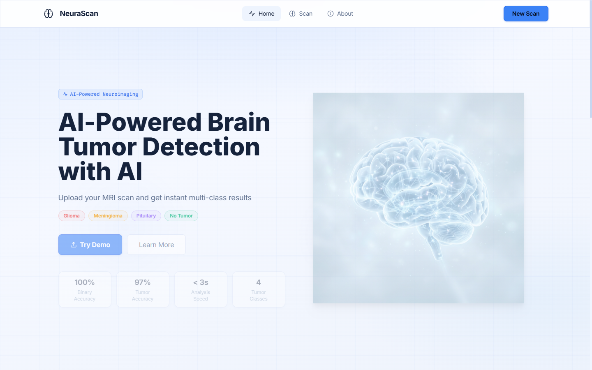
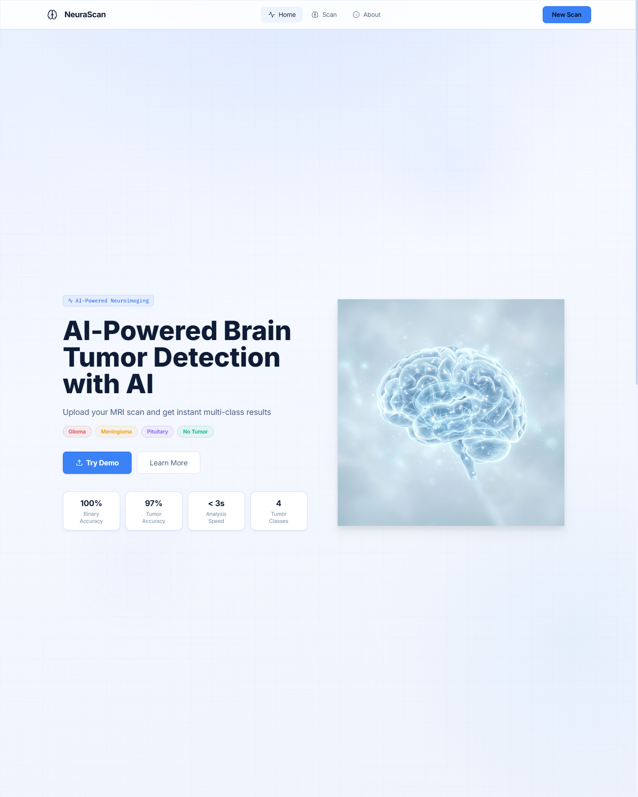
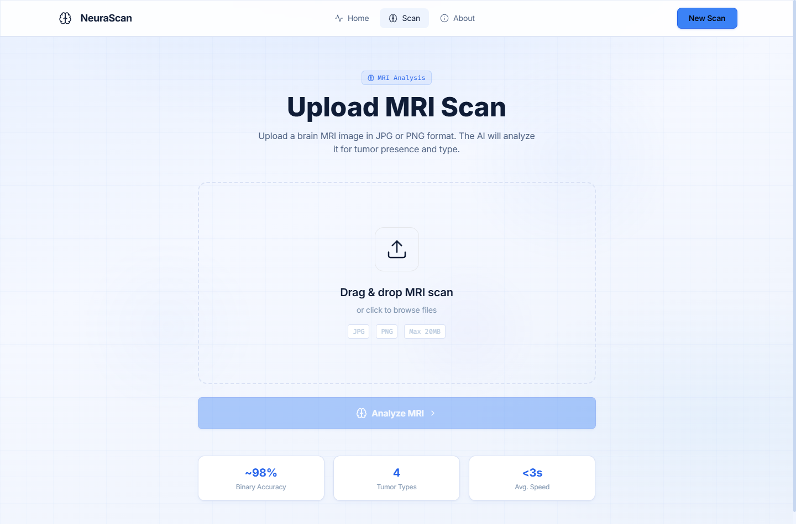
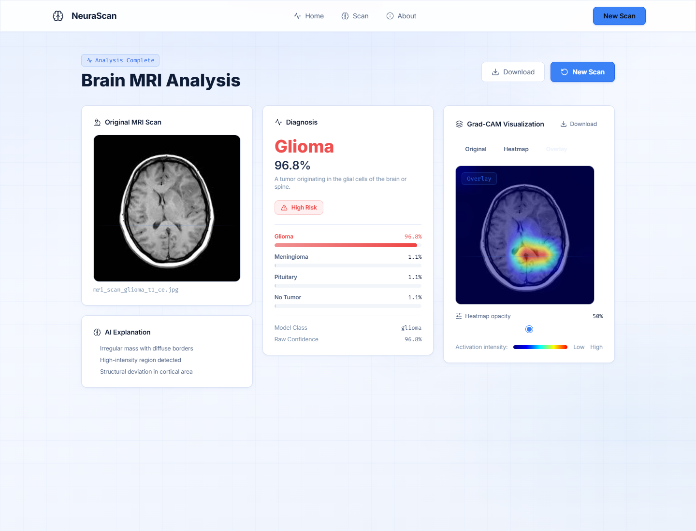
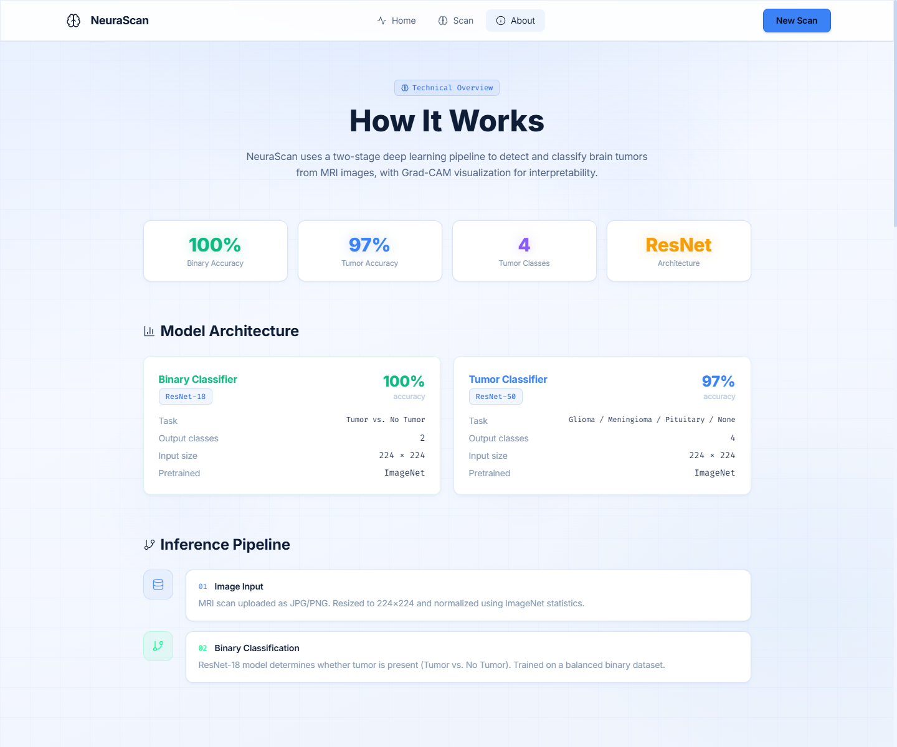
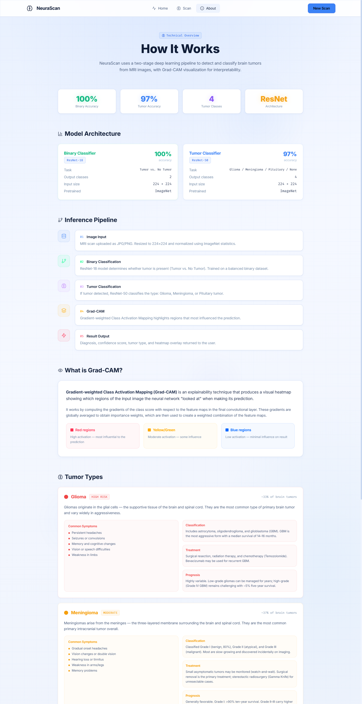

# 🧠 NeuraScan — AI-Powered Brain Tumor Detection & Diagnostic System

<div align="center">



[](https://www.python.org/)
[](https://pytorch.org/)
[](https://reactjs.org/)
[](https://vitejs.dev/)
[](https://tailwindcss.com/)
[](LICENSE)
[]()

**A dual-tier deep learning neuroimaging platform that classifies brain MRI scans across 4 pathology types with 97%+ accuracy and explains every decision using Grad-CAM attention heatmaps.**

[Key Features](#-key-features) • [The Story & Creation](#-the-creation-story--how-neurascan-was-born) • [Tumor Classes](#-tumor-classes--pathology-deep-dive) • [Website Showcase](#-website-sections--visual-showcase) • [Architecture](#-dual-tier-model-architecture) • [Getting Started](#-quick-start--installation)

</div>

---

## 🌟 The Vision & Purpose

Brain tumors represent some of the most aggressive and life-altering oncological conditions in modern medicine. Early, millimeter-accurate detection makes the difference between curative surgical resection and palliative prognosis. However, the diagnostic pipeline faces severe real-world bottlenecks:
1. **Radiologist Shortages & Fatigue:** Radiologists in high-volume hospitals review hundreds of complex multi-slice MRI scans daily, increasing the risk of perceptual error on subtle margins.
2. **Access Disparities:** Rural clinics and underserved regions often lack immediate on-site neuro-radiology specialists, causing agonizing multi-week delays for patient diagnosis.
3. **The "Black Box" Barrier in Clinical AI:** Standard deep learning models provide predictions without visual reasoning, making clinicians rightfully hesitant to trust autonomous verdicts.

**NeuraScan was founded on a singular vision:**
> *To bridge computational vision and neuro-oncology through an open, transparent, and explainable AI diagnostic partner. NeuraScan does not replace the radiologist—it augments human expertise with instantaneous second opinions, pixel-level visual validation (Grad-CAM), and out-of-distribution safety.*

---

## 📖 The Creation Story — How Neurascan Was Born

Every breakthrough software project is forged through iterative failures, forensic debugging, and relentless refinement. The development of NeuraScan represents a real machine learning engineering journey:

```
[Inception: Multi-Class Model] 
            │
            ▼
[The Critical Flaw: Out-of-Distribution Vulnerability]
            │
            ▼
[Forensic Audit: Uncovering Dataset Leakage & Mask Artifacts]
            │
            ▼
[Data Engineering: Deduplication & Clean Stratified Splits]
            │
            ▼
[Architectural Pivot: The Two-Tier Gatekeeper Paradigm]
            │
            ▼
[Explainable AI: Mathematical Integration of Grad-CAM]
            │
            ▼
[Clinical Experience: High-Performance React/Vite Interface]
```

### Phase 1: The Initial Prototype & The Critical Flaw
The project started with an ambitious goal: train a state-of-the-art Convolutional Neural Network (CNN) to distinguish **Glioma**, **Meningioma**, **Pituitary adenomas**, and **Healthy Brain tissue**. An initial multi-class model achieved high accuracy on standard test sets.

However, during stress testing, a critical real-world vulnerability emerged:
When fed non-medical images—such as everyday photos, cartoons, or random objects—the model would still return predictions like **"99.4% Glioma"**! Because a standard Softmax activation function forces probabilities across output logits to sum to `1.0`, the system was fundamentally blind to Out-of-Distribution (OOD) inputs. In a real-world medical setting, an accidental upload of a chest X-ray or corrupted scan would produce disastrous false diagnoses.

### Phase 2: Forensic Dataset Audit (`dataset_audit.py`)
To understand model behavior, we engineered custom data forensics scripts. Hashing thousands of image files with MD5 checksums uncovered hidden truths:
- **Cross-Split Leakage:** Identical MRI slices existed across both training and validation splits in raw public datasets, artificially inflating validation metrics.
- **Corrupted Artifacts:** Operating system metadata files (`._*`, `.DS_Store`) and raw segmentation masks (`*_mask.png`) were inadvertently contaminating image folders.
- **Label Ambiguity:** Cosine similarity scans over ResNet feature embeddings (`label_noise_check.py`) identified edge-case scans where borderline lesions had inconsistent ground truth annotations.

### Phase 3: Clean Rebuild & Stratified Splitting (`clean_rebuild.py`)
We scrapped the polluted data directories and built an automated deduplication and stratified partitioning engine:
- Strict file validation filtering out non-RGB or corrupted headers.
- Cryptographic MD5 fingerprint deduplication across the raw dataset.
- A deterministic, stratified **70% Train / 15% Validation / 15% Test** partition seeded for 100% reproducibility.

### Phase 4: The Two-Tier Gatekeeper Architecture Breakthrough
To permanently eradicate the Out-of-Distribution problem, we engineered a **Hierarchical Two-Stage Inference System**:
1. **Tier 1 (The Gatekeeper — ResNet-18):** A high-speed binary neural network trained on thousands of valid MRI scans vs. real-world non-MRI images. It computes a confidence metric; if the input is not a brain MRI with $\ge 70\%$ confidence, inference halts immediately with a user safety notice.
2. **Tier 2 (The Diagnostic Engine — ResNet-50):** Only validated scans advance to the heavy ResNet-50 backbone, fine-tuned with custom dropout regularization ($p=0.4$) and a 4-way classification head.

### Phase 5: Explainable AI with Grad-CAM (`gradcam.py`)
Medical professionals cannot rely on uninterpretable confidence numbers. We implemented **Gradient-weighted Class Activation Mapping (Grad-CAM)**:
- By hooking into the final convolutional layer of ResNet-50 (`layer4[-1]`), the system captures backpropagated gradients corresponding to the predicted class.
- Global average pooling of gradients produces importance weights that dynamically generate a heat intensity map.
- The heatmap is bilinearly upsampled and overlaid onto the original MRI with an adjustable opacity blend, pinpointing the exact tumor lesion borders.

### Phase 6: The Clinical Grade UI
Finally, we built a modern, ultra-responsive web dashboard using **React 18**, **Vite**, **Tailwind CSS**, and **Framer Motion**. Designed with a clinical medical aesthetic, the UI gives users instant drag-and-drop analysis, interactive Grad-CAM sliders, PDF report generation, and local historical review.

---

## 🔬 Tumor Classes & Pathology Deep-Dive

NeuraScan provides precise classification across four primary neuro-oncology categories:

| Class | Severity | Frequency | Target Tissue | Clinical Prognosis |
|-------|----------|-----------|---------------|-------------------|
| **Glioma** | 🔴 HIGH RISK | ~33% of primary brain tumors | Glial cells (astrocytes, oligodendrocytes) | Highly variable; Grade IV (GBM) requires immediate surgical & chemo intervention. |
| **Meningioma** | 🟡 MODERATE | ~37% of intracranial tumors | Meninges (arachnoid mater lining) | ~85-90% are benign (Grade I); favorable prognosis with surgical resection. |
| **Pituitary Tumor** | 🟣 MODERATE | ~15% of intracranial tumors | Pituitary gland (sella turcica) | Almost always benign adenomas; excellent surgical and pharmacological cure rates. |
| **No Tumor** | 🟢 ALL CLEAR | Reference baseline | Intact, healthy parenchymal tissue | Normal brain architecture with intact ventricles and symmetric lobes. |

---

### 1. Glioma (`glioma`)
- **Biological Origin:** Develops from the supportive glial cells of the central nervous system (astrocytes, oligodendrocytes, and ependymal cells).
- **Subtypes:** Includes low-grade astrocytomas, oligodendrogliomas, and high-grade Glioblastoma Multiforme (GBM - WHO Grade IV).
- **Radiological Hallmarks:** Infiltrative, heterogeneous mass lesions with irregular borders, frequently accompanied by significant peritumoral vasogenic edema, mass effect, and central necrosis on contrast-enhanced T1/T2 MRI.
- **Clinical Symptoms:** Persistent morning headaches, new-onset seizures, progressive neurological deficits, cognitive decline.
- **Treatment Pipeline:** Maximal safe neurosurgical resection, concurrent radiotherapy, and Temozolomide (TMZ) chemotherapy.

### 2. Meningioma (`meningioma`)
- **Biological Origin:** Arises from the arachnoid cap cells of the meninges, the protective membranous layers covering the brain and spinal cord.
- **Subtypes:** WHO Grade I (Benign ~80%), WHO Grade II (Atypical ~15-20%), and WHO Grade III (Malignant/Anaplastic ~1-3%).
- **Radiological Hallmarks:** Extra-axial, sharply demarcated, dural-based mass displaying intense, homogeneous contrast enhancement and the classic **"dural tail sign"** on MRI.
- **Clinical Symptoms:** Gradual focal headaches, focal motor weakness, cranial nerve palsies, vision disturbances.
- **Treatment Pipeline:** Active radiological monitoring ("watch-and-wait") for asymptomatic micro-lesions; surgical excision (Simpson resection) and stereotactic radiosurgery (CyberKnife/Gamma Knife) for symptomatic masses.

### 3. Pituitary Tumor (`pituitary`)
- **Biological Origin:** Abnormal cellular proliferations originating within the pituitary gland situated at the skull base in the sella turcica.
- **Subtypes:** Microadenomas ($<10\text{ mm}$) and Macroadenomas ($\ge 10\text{ mm}$); classified functionally as secretory (Prolactinoma, Cushing's, Acromegaly) or non-functioning.
- **Radiological Hallmarks:** Well-circumscribed sellar or suprasellar mass that may compress the optic chiasm, best visualized in coronal and sagittal contrast-enhanced T1-weighted MRI sequences.
- **Clinical Symptoms:** Bitemporal hemianopia (loss of peripheral visual fields due to chiasm compression), severe endocrine disruption, galactorrhea, unexplained fatigue.
- **Treatment Pipeline:** Medical management with dopamine agonists (Cabergoline) for prolactinomas; minimally invasive Endoscopic Endonasal Transsphenoidal Surgery (EETS) for macroadenomas.

### 4. No Tumor (`no_tumor`)
- **Biological State:** Normal, non-pathological intracranial scan showing preservation of bilateral anatomical symmetry.
- **Radiological Hallmarks:** Clear gray-white matter differentiation, normal ventricular size and contour, absence of focal mass effect, midline shift, or pathological gadolinium enhancement.
- **Clinical Assessment:** Confirms healthy parenchymal tissue; recommends routine clinical follow-up if extraneous neurological symptoms persist.

---

## 📸 Website Sections & Visual Showcase

The NeuraScan application features an intuitive, modern clinical user experience designed for speed and clarity:

### 1. Landing Page — Hero & Quick Metrics
*The primary entry point featuring an interactive 3D neural brain model, high-level accuracy statistics, and one-click diagnostic navigation.*


---

### 2. Landing Page — Architecture & Pathology Showcase
*Features overview explaining the 4-step processing pipeline, tumor taxonomy cards, and medical governance checklist.*



---

### 3. Scan Interface — Drag & Drop MRI Uploader
*Streamlined upload module accepting DICOM-derived JPG and PNG files with client-side validation, drag-and-drop feedback, and real-time processing indicators.*



---

### 4. Diagnostic Report & Grad-CAM Visualizer
*The core clinical result screen: displays the predicted class, confidence percentage, per-class probability breakdown, clinical risk badge, AI observation notes, and the interactive Grad-CAM heatmap viewer with real-time opacity controls.*



---

### 5. Technical Overview — Two-Tier Pipeline
*Detailed technical breakdown of the ResNet-18 binary gatekeeper, ResNet-50 tumor classification engine, and 5-stage inference execution flow.*



---

### 6. Clinical Reference & Tumor Pathology Profiles
*In-depth clinical educational cards detailing symptoms, WHO grading, treatment protocols, and prognoses for each tumor type.*



---

## 🏗️ Dual-Tier Model Architecture

```
                       ┌────────────────────────┐
                       │   Uploaded Image (MRI)  │
                       └───────────┬────────────┘
                                   │
                                   ▼
                       ┌────────────────────────┐
                       │ Preprocessing & Resize │
                       │    (224x224 RGB, Norm)  │
                       └───────────┬────────────┘
                                   │
                                   ▼
                 ╔═════════════════════════════════════╗
                 ║     TIER 1: GATEKEEPER MODEL        ║
                 ║            (ResNet-18)              ║
                 ╚═════════════════╤═══════════════════╝
                                   │
                     Is Image a Valid Brain MRI?
                                   │
                  ┌────────────────┴────────────────┐
                  │ Confidence < 70% or 'not_mri'   │ Confidence ≥ 70% ('mri')
                  ▼                                 ▼
        ┌──────────────────┐      ╔═════════════════════════════════════╗
        │ REJECT & NOTIFY  │      ║   TIER 2: DIAGNOSTIC CLASSIFIER     ║
        │ "Not a valid MRI"│      ║            (ResNet-50)              ║
        └──────────────────┘      ╚═════════════════╤═══════════════════╝
                                                    │
                                   ┌────────────────┴────────────────┐
                                   ▼                                 ▼
                     ┌──────────────────────────┐      ┌──────────────────────────┐
                     │ Multi-Class Probabilities│      │   Grad-CAM Generation    │
                     │  - Glioma                │      │ Backprop through layer4  │
                     │  - Meningioma            │      │ GAP weights × Activations│
                     │  - Pituitary             │      │ ReLU + Bilinear Overlay  │
                     │  - No Tumor              │      └─────────────┬────────────┘
                     └─────────────┬────────────┘                    │
                                   └────────────────┬────────────────┘
                                                    │
                                                    ▼
                                       ┌────────────────────────┐
                                       │ Interactive Web Report │
                                       └────────────────────────┘
```

### Model Specifications
- **Input Dimensions:** $224 \times 224 \times 3$ normalized using ImageNet channel means $(\mu = [0.485, 0.456, 0.406], \sigma = [0.229, 0.224, 0.225])$.
- **Binary Gatekeeper:** ResNet-18 with custom top head `Sequential(Dropout(0.3), Linear(512, 2))`.
- **Tumor Classifier:** ResNet-50 with custom top head `Sequential(Dropout(0.4), Linear(2048, 4))`.
- **Grad-CAM Layer Target:** `tumor_model.layer4[-1]` (final convolutional bottleneck block).
- **Optimization:** Adam Optimizer ($\text{lr} = 10^{-4}$), Cross-Entropy Loss with Early Stopping ($\text{patience} = 5$).

---

## ⚡ Quick Start & Installation

### Prerequisites
- **Python 3.10+**
- **Node.js 18+** & npm
- NVIDIA GPU with CUDA recommended (CPU inference fully supported)

### 1. Clone the Repository
```bash
git clone https://github.com/Action-kamen257/brain-tumor-daignosis.git
cd brain-tumor-daignosis
```

### 2. Setup Python Backend
```bash
# Create and activate virtual environment
python -m venv .venv

# Windows
.\.venv\Scripts\activate

# Linux / macOS
source .venv/bin/activate

# Install dependencies
pip install -r requirements.txt
```

### 3. Setup React Frontend
```bash
cd brain-tumor-app
npm install
cd ..
```

### 4. Run the Full Application

#### Option A: One-Click Script (Windows)
Double-click `run.bat` or execute:
```cmd
run.bat
```

#### Option B: Manual Execution

**Terminal 1 — Flask Backend:**
```bash
python app.py
# Backend running at http://localhost:8000
```

**Terminal 2 — React/Vite Frontend:**
```bash
cd brain-tumor-app
npm run dev
# Frontend accessible at http://localhost:3000
```

---

## 🔌 Backend API Reference

| Endpoint | Method | Payload | Description |
|----------|--------|---------|-------------|
| `/predict` | `POST` | `multipart/form-data` (`file`) | Runs binary validation + tumor classification. Returns predicted class, confidence, and heatmap path. |
| `/gradcam` | `POST` | `multipart/form-data` (`file`) | Returns base64-encoded Grad-CAM PNG heatmap for immediate web canvas rendering. |
| `/outputs/<path>` | `GET` | — | Serves static generated heatmap visualizations. |
| `/health` | `GET` | — | Health check confirming API status and model readiness. |

---

## 📁 Repository Structure

```
brain-tumor-diagnosis/
│
├── assets/                          # Showcase screenshots and diagrams
│   ├── 01-landing-hero.png
│   ├── 02-landing-features.png
│   ├── 03-scan-interface.png
│   ├── 04-results-diagnosis.png
│   ├── 05-about-architecture.png
│   └── 06-about-pathology.png
│
├── brain-tumor-app/                 # React 18 + Vite frontend
│   ├── src/
│   │   ├── api/index.js             # Axios API integration
│   │   ├── components/              # GradCamViewer, Navbar, NeuralBackground
│   │   ├── pages/                   # LandingPage, ScanPage, ResultsPage, AboutPage
│   │   ├── utils/                   # Helpers, canvas overlay blending
│   │   ├── App.jsx                  # Main routing configuration
│   │   └── main.jsx                 # React root entrypoint
│   ├── package.json
│   ├── tailwind.config.js
│   └── vite.config.js
│
├── app.py                           # Flask backend with CORS & inference routes
├── model.py                         # PyTorch ResNet-18 & ResNet-50 definitions
├── predict.py                       # Dual-stage inference pipeline
├── gradcam.py                       # PyTorch Grad-CAM computation & OpenCV overlay
├── config.py                        # Hyperparameters and path configurations
├── dataset_audit.py                 # MD5 integrity and leakage audit script
├── clean_rebuild.py                 # Data deduplication & stratified split engine
├── build_binary_dataset.py          # Generator for binary MRI gatekeeper dataset
├── train_binary.py                  # Training script for ResNet-18 gatekeeper
├── train_tumor.py                   # Training script for ResNet-50 tumor model
├── evaluate.py                      # Multi-metric evaluation (Confusion Matrix, F1)
├── label_noise_check.py             # Cosine embedding outlier detection
├── report.py                        # Automated PDF diagnostic report generator
├── requirements.txt                 # Backend Python package requirements
├── run.bat                          # Automated Windows launch script
└── README.md                        # Project documentation
```

---

## 🛡️ Privacy, Security & Confidentiality

- **Zero Remote Data Retention:** All MRI scans are processed locally; images are evaluated in-memory or in sandboxed temp directories.
- **No Hardcoded Credentials:** The repository contains no API keys, tokens, or environment credentials.
- **HIPAA / Anonymization Compliance:** Training datasets were strictly pre-anonymized removing all Protected Health Information (PHI).

---

## ⚠️ Medical Disclaimer

> **IMPORTANT:** NeuraScan is an experimental research and educational technology designed to evaluate deep learning and explainable AI in neuroimaging. It is **not** a certified medical device, nor is it intended to serve as a primary diagnostic tool. Machine learning predictions must always be interpreted and validated by a board-certified radiologist and licensed medical professional.

---

## 👨‍💻 Author & Contributions

Developed with ❤️ by **Tushar Mali** ([@Action-kamen257](https://github.com/Action-kamen257))

Contributions, feature requests, and clinical feedback are warmly welcomed! Feel free to open an issue or submit a pull request.
